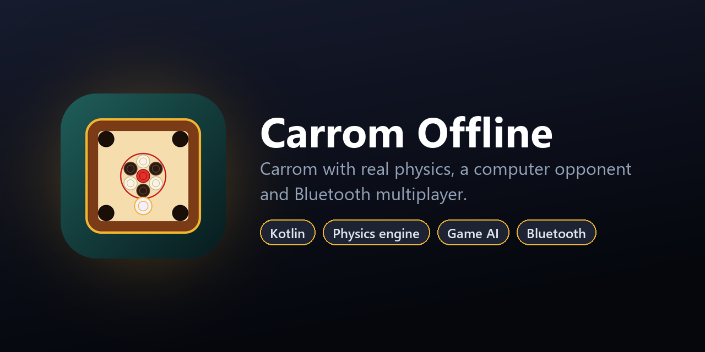

<p align="center">
  
</p>

<p align="center">
  <a href="https://github.com/souvik-das-tech/CarromOffline/releases/latest"></a>
  
  
  
  
  
</p>

# Carrom Offline

Carrom for **2 players** (1 vs 1) or **4 players** (2 vs 2 teams), on one phone or tablet, or
across up to four phones over **Bluetooth**. The app has no internet permission, no accounts
and no ads.

The game runs on a hand-written 2D physics engine and a computer opponent that simulates
candidate shots before it plays.

## Download

Get the latest APK from **[Releases](https://github.com/souvik-das-tech/CarromOffline/releases/latest)**
(Android 8.0 or newer).

## Features

- **Real physics.** Coins slide with friction, bounce off each other and the cushions, and drop
  into the corner pockets. The striker is about three times as heavy as a coin. Board
  dimensions follow the standard tournament board, in millimetres.
- **Slingshot aiming.** Move the striker along the wooden rail under the board (or tap a spot on
  your baseline), then pull back on it like a slingshot. A guide line shows which coin you
  will hit and where that coin will go, and a ring shows the power.
- **Computer opponent.** Any seat can be the computer. It tries many shots in a fast simulation,
  plays the best one, and adds a little human-like wobble.
- **Full rules.** White breaks. Pocket your colour to shoot again. The queen (+3) must be covered
  by one of your coins in the same or the next shot. A striker in a pocket is a foul and a coin
  comes back. The queen must be covered before your last coin, and pocketing the other side's
  last coin loses.
- **Scoring and saves.** A winner screen shows the points (the other side's coins left, plus 3
  for the queen). Games save after every shot and can be continued from the menu.

## Bluetooth multiplayer

Each player uses their own phone over classic Bluetooth only (no Wi-Fi, no internet). One phone
taps **CREATE ROOM** and the others tap **JOIN ROOM** and pick that phone's name. The host taps
**START**, and empty seats go to the computer. Up to 4 phones can play.

- **Host-authoritative**: the host runs the simulation and broadcasts the state, and guests
  only send their own moves.
- Each phone shows the board rotated so that its own side is at the bottom.
- If a guest leaves or drops out of range, the computer takes over that seat. If the host
  leaves, the game ends for everyone.
- Rooms use **insecure RFCOMM** sockets, so phones don't need to be paired first. A room
  identifier keeps other Bluetooth apps (including Ludo Offline) from connecting by mistake.

## Architecture

```
app/src/main/java/com/bbcl/carromoffline/
├── Physics.kt       Board geometry and the rigid-disc simulation (friction, collisions, pockets)
├── CarromGame.kt    Pure game rules: turns, fouls, queen and cover, scoring
├── GameModel.kt     Game loop: aiming, running shots, computer turns, saving, Bluetooth rooms
├── Bluetooth.kt     RFCOMM host/guest transport, message framing, permissions
├── BoardView.kt     Board, coins and animations drawn on a Compose Canvas
├── GameScreen.kt    In-game UI: rail, aiming, scores, winner screen
├── SetupScreen.kt   Players, seats, computer opponents, continue a saved game
├── LobbyScreen.kt   Create or join a Bluetooth room
├── Ui.kt            Shared UI components
└── MainActivity.kt  Entry point
```

The rules (`CarromGame.kt`) and physics (`Physics.kt`) have no Android dependencies, so they
are covered by plain JVM unit tests.

## Tests

```bash
./gradlew testDebugUnitTest
```

The tests cover the starting layout, a straight shot pocketing a coin, a break shot settling
inside the board, striker fouls returning coins, the queen-cover rule, and complete
computer-vs-computer games running to a finish.

## Tech stack

- **Kotlin 2.4**, **Jetpack Compose** (Material 3, Canvas), Coroutines
- Android classic Bluetooth (RFCOMM)
- JUnit 4 for unit tests
- Min SDK 26 (Android 8.0), target SDK 36

## Permissions

| Permission | Why |
| --- | --- |
| `BLUETOOTH_SCAN` / `BLUETOOTH_CONNECT` / `BLUETOOTH_ADVERTISE` (Android 12+) | Bluetooth rooms only |
| `BLUETOOTH`, `BLUETOOTH_ADMIN`, location (Android 11 and lower) | Older Android versions require location access to find nearby Bluetooth devices |

There is no `INTERNET` permission.

## Build from source

Requirements: Android Studio (or the Android SDK with platform 36) and JDK 17+.

```bash
git clone https://github.com/souvik-das-tech/CarromOffline.git
cd CarromOffline
./gradlew assembleRelease     # app/build/outputs/apk/release/app-release.apk (R8-minified)
```

The release build is signed with the debug key so it installs out of the box. Add your own
`signingConfig` before publishing to a store. The launcher icons and store logo are drawn in
code by `python tool/generate_icons.py` (Pillow).

## License

Released under the [MIT License](LICENSE).

## Author

**Souvik Das** · [GitHub @souvik-das-tech](https://github.com/souvik-das-tech)

If you find this project useful, please consider giving it a ⭐.
